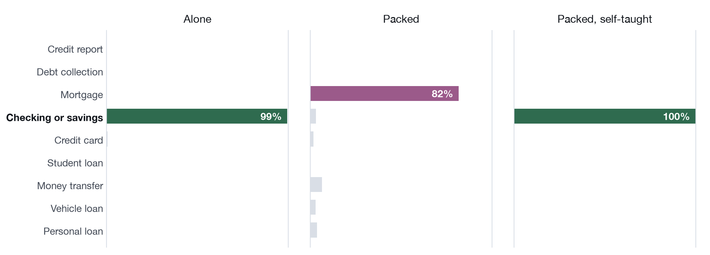
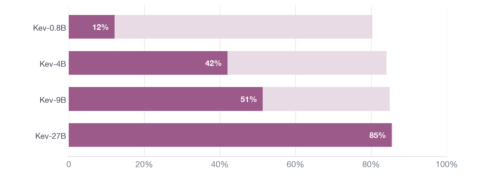
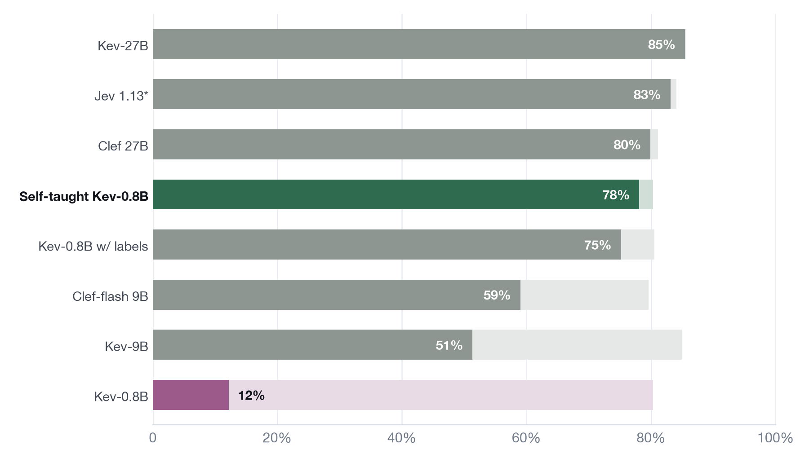

# kev-selfteach

A 0.8B decision model that teaches itself to read about 1,000 documents at once, with no labels.

Write-up: [A decision model that teaches itself](https://www.larrisx.com/studio/self-taught-kev) ·
Model: [LarrisX/kev-0.8b-selfteach](https://huggingface.co/LarrisX/kev-0.8b-selfteach) ·
Test: [LarrisX/packed-complaints](https://huggingface.co/datasets/LarrisX/packed-complaints)


*Accuracy as more complaints are packed into one read, past the 64k window of today's decision models.*

Decision models such as [Kev](https://github.com/jaredpalmer/kev), TypeSafe's Jev and Cloudflare's Clef read an input
once and answer typed questions about it, with a probability for each option. Every question branches off that single
read, so asking about every item in a long input costs a small fraction of asking about each one separately.

Asked which product each of 1,980 CFPB consumer complaints is about (nine options), Kev-0.8B gets **80%** right one
complaint at a time. Pack 246 of them into one 64k-token input and it drops to **12%**, barely above chance (11%). After
self-teaching it scores **78%** at 64k, **79%** with ~490 complaints (128k tokens) and **75%** with ~990 (256k).

## Why it breaks



The model knows the answers; it can't find the right complaint. Packed at 64k, Kev-0.8B gives the answer it gives alone
only 13% of the time, and 56% of its wrong answers name the product of the first or last complaint in the input.

Bigger Kevs fall too: Kev-4B scores 42% at 64k and Kev-9B 51%. Only Kev-27B, the one Kev trained on long documents,
holds (85%).



## How it works


1. **Teacher.** Released Kev-0.8B reads each training complaint by itself and gives a probability for each option.
2. **Student.** The same model reads that complaint packed among up to ~120 others and is trained (soft targets, a LoRA
   on Kev's own trainer) to give the same probabilities.

- **Fresh complaints.** 5,219 training complaints that aren't in Kev's training data or in the test.
- **Mixed training.** About a third of training examples are single items read alone, and Kev's other kinds of
  questions are mixed in (also answered by the teacher), so the model keeps answering short inputs as before.
- **No labels for the complaints, no bigger model, no hosted-model outputs.** One run is 46 minutes on one H100 (~$2).

## Results



*Accuracy with 246 complaints in one read (64k tokens). The pale part of each bar is the same model reading each
complaint alone. Jev's window is 32k, so it read each input as two halves.*

- **78% at 64k** against 80% alone (mean of two training runs, 78.4% and 77.8%), up from 12%.
- **It beats the same model trained on the real labels** (75%). The two trained on different complaints, so this mixes
  method and data.
- **It beats Kev-9B** (51%) and lands within 2 points of Clef 27B (80%). Kev-27B stays 7 points ahead, but it is also
  better on a complaint read alone (86% vs 80%).
- **Packed answers match the alone answers 89% of the time**, up from 13%.
- **Nothing else broke.** On Kev's own suites, paired against released Kev: decision-v7 +0.4 [−0.5, +1.4], transfer-v4
  −1.3 [−3.4, +0.8].

## Past the 64k window

Same teacher answers, longer training documents, each round starting from the last:

| Round | Starts from | Training documents | Time on one H100 |
|---|---|---|---|
| 1 (`fresh-32k`) | Kev-0.8B | up to 32k tokens | 46 min |
| 2 (`fresh-64k`) | round 1 | up to 64k tokens | 42 min |
| 3 (`fresh-128k`) | round 2 | up to 128k tokens | 45 min |


*Diamonds mark the longest document each round trained on. Each round holds up to about twice that length.*

Round 3 scores **79% at 128k** and **75% at 256k**; released Kev-0.8B is at chance at both. Scoring past 64k uses
`bench/chunked_scorer.py`, which runs Kev's scorer with the questions in batches; it matches Kev's unpatched scorer
on every question where both run. Training past 64k lifts Kev's 64k training cap for that run (`infra/runpod/train.sh`).

## Limits

- **The teacher sets the ceiling.** The student can't beat its own read-alone accuracy (80%). Swapping in Kev-27B as the
  teacher (86% alone) left the student at 81% alone and 78% at 64k: self-teaching transfers finding the right item, not
  the teacher's extra knowledge, at least at this size and budget.
- **More items, bigger drop.** A 64k input holds about 14 [CUAD](https://www.atticusprojectai.org/cuad) contracts
  against 246 complaints. Packing costs Kev-0.8B only 9 points there (71% → 62%), and self-teaching on complaints wins
  back about half (67%).
- **A weak teacher teaches nothing.** Kev-0.8B is near chance on ContractNLI NDA questions (49% on three options), so
  adding NDAs barely moved contracts (70%). With Kev-27B as the NDA teacher (83% alone), contracts at 64k rose about
  3 points (73%).
- **Locate-and-read only.** Each question is about one item; the tests don't ask for reasoning across items.
- **Seeds.** The 64k result is two training runs; rounds 2–3 and the Kev-27B-teacher run were trained once.

## Layout

```
selfteach/          training side: one builder per training set, then targets and analysis
  common.py           shared: items, packing into documents, Kev's records, tokenizer and context
  build_kev_items.py  kev-items: the first attempt (Kev's own training complaints), and the decision-records teacher suite
  build_fresh.py      fresh-32k: fresh CFPB complaints, documents to 32k (the headline model; --seed 1 for fresh-32k-seed1)
  build_ndas.py       fresh-32k-ndas: the same plus fresh ContractNLI NDAs
  build_longer.py     fresh-64k, fresh-128k: the same items repacked into longer documents
  filter.py           drop packed records that don't fit the training context (Kev's environment)
  targets.py          teacher answers -> soft targets (Kev's environment, on the GPU box)
  report.py           self-taught analyses (agreement with the alone answer, edge errors) -> results/selfteach.json
bench/              test side: one folder per test
  complaints/         the packed-complaints test
    build.py            suite, alone to 64k
    build_long.py       suite, 128k and 256k
    split.py            scoring copies with each document's questions in groups (fits Kev's scorer in GPU memory)
    report.py           -> results/complaints.json
    report_long.py      -> results/complaints_long.json
    jev.py, clef.py     hosted references (evaluation only)
  contracts/          the packed-contracts test (CUAD, Kev's longdoc layout)
    build.py, report.py (-> results/contracts.json), hosted.py (Jev and Clef, evaluation only)
  regression.py       Kev's own short-question suites, paired -> results/regression/<run>.json
  chunked_scorer.py   Kev's scorer with question branches chunked, for 128k+ (evaluation only)
  chunked_check.py    checks the chunked scorer against Kev's unpatched one
  hosted.py           shared Jev / Clef API client
infra/
  runpod/             GPU steps on one H100: teacher.sh, train.sh, score.sh (+ setup, self-stop); README has every run
  modal/              the Modal app used for the label-trained baseline and the first Kev reads
results/            tracked summaries (JSON); figures.py draws results/figures/ from them
data/               local only: Kev checkout, raw data, suites, model rows, checkpoints
```

## Setup

```bash
uv sync
git clone https://github.com/jaredpalmer/kev data/kev && git -C data/kev checkout fe64b12   # Kev's code and suites
(cd data/kev && uv sync --frozen)   # Kev's own environment, for kev.benchmark / kev.train and the scripts that import kev
```

Inputs expected under `data/` (not redistributed):

| Path | What |
|---|---|
| `data/kev/` | Kev at commit fe64b12 (Apache-2.0), including `evals/decision-v2`, `evals/v7`, `evals/v4`, `evals/longdoc-v1` |
| `data/cfpb/train-00010.parquet` | CFPB complaints, shard 10 of the Hub snapshot `davidheineman/consumer-finance-complaints-large` @ 44cfa17 (US government work) |
| `data/cfpb/kev_documents_v1_train.jsonl` | Kev's documents-v1 train split, used only to keep it out of the test and the fresh items |
| `data/contractnli/` | ContractNLI (CC BY 4.0), for the fresh-32k-ndas run |

## Reproduce

```bash
# the tests (CPU)
uv run python -m bench.complaints.build --out data/packed-complaints-v0
uv run python -m bench.complaints.split            # scoring copies: packed-complaints-v0-split{,-long}
uv run python -m bench.complaints.build_long       # 128k / 256k: packed-complaints-v1{,-check}
PYTHONPATH=data/kev data/kev/.venv/bin/python bench/contracts/build.py

# training data (CPU): each run's items alone (for the teacher) and its packed documents, under data/selfteach/<run>/
uv run python -m selfteach.build_kev_items                                            # kev-items, and the decision records every run reuses
uv run python -m selfteach.build_fresh                                                # fresh-32k (headline)
uv run python -m selfteach.build_fresh --seed 1 --out data/selfteach/fresh-32k-seed1  # its second seed
PYTHONPATH=data/kev data/kev/.venv/bin/python selfteach/build_ndas.py                 # fresh-32k-ndas
uv run python -m selfteach.build_longer                                               # fresh-64k
uv run python -m selfteach.build_longer --records 400 --asked 12 --min_len 32000 --max_len 125000 --seed 1 --out data/selfteach/fresh-128k
data/kev/.venv/bin/python selfteach/filter.py data/selfteach/<run>/packed.jsonl        # every run; add 65536 / 131072 for fresh-64k / fresh-128k

# GPU (one H100): teacher answers, training, scoring -> infra/runpod/README.md

# reports, from the score rows in data/kevbench/results/
uv run python -m bench.complaints.report && uv run python -m bench.complaints.report_long
uv run python -m bench.contracts.report && uv run python -m selfteach.report
uv run python -m bench.regression fresh-32k decision-v7 transfer-v4   # each run
uv run python results/figures.py                                      # the figures above
```

## Notes

- All scores use Kev's own scorer (`kev.benchmark`) and suites. Our scoring of released Kev-0.8B 1.0 reproduces Kev's published rows bit for bit.
- Jev and Clef were queried only for evaluation. No hosted-model output is used to train anything.
- The label-trained comparison (delta-v1) was built with earlier code that is not part of this repo; its results are in `results/`.

## Licence

Apache-2.0 (see [LICENSE](LICENSE) and [NOTICE](NOTICE)). Data is not redistributed and keeps its own licence.
