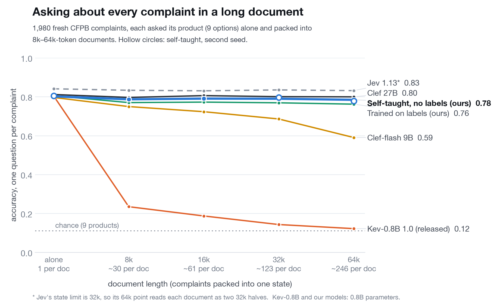

# kev-selfteach

Self-taught long context for [Kev-0.8B](https://github.com/jaredpalmer/kev). The model reads each item alone, and those
answers become its own training targets for reading the same items packed into one long document. No labels, no bigger
model, no hosted-model outputs.



Asked about every complaint in a 64k-token document (~246 complaints, nine-way product question), released Kev-0.8B 1.0
scores 0.12 (chance is 0.11). Self-taught, it scores 0.78, against 0.80 reading each complaint alone. Two more rounds on
longer documents reach 0.79 at 128k (~490 complaints) and 0.75 at 256k (~990).

## Layout

```
selfteach/          training side: one builder per training set, then targets and analysis
  common.py           shared: items, packing into documents, Kev's records, tokenizer and context
  build_kev_items.py  kev-items: the first attempt (Kev's own training complaints), and the decision-records teacher suite
  build_fresh.py      fresh-32k: fresh CFPB complaints, documents to 32k (the headline model; --seed 1 for fresh-32k-seed1)
  build_ndas.py       fresh-32k-ndas: the same plus fresh ContractNLI NDAs
  build_longer.py     fresh-64k, fresh-128k: the same items repacked into longer documents
  filter.py           drop packed records that don't fit the training context (Kev's environment)
  targets.py          teacher answers -> soft targets (Kev's environment, on the GPU box)
  report.py           self-taught analyses (agreement with the alone answer, edge errors) -> results/selfteach.json
bench/              test side: one folder per test
  complaints/         the all-complaints test
    build.py            suite, alone to 64k
    build_long.py       suite, 128k and 256k
    split.py            scoring copies with each document's questions in groups (fits Kev's scorer in GPU memory)
    report.py           -> results/complaints.json
    report_long.py      -> results/complaints_long.json
    jev.py, clef.py     hosted references (evaluation only)
  contracts/          the all-contracts test (CUAD, Kev's longdoc layout)
    build.py, report.py (-> results/contracts.json), hosted.py (Jev and Clef, evaluation only)
  regression.py       Kev's own short-question suites, paired -> results/regression/<run>.json
  chunked_scorer.py   Kev's scorer with question branches chunked, for 128k+ (evaluation only)
  chunked_check.py    checks the chunked scorer against Kev's unpatched one
  hosted.py           shared Jev / Clef API client
infra/
  runpod/             GPU steps on one H100: teacher.sh, train.sh, score.sh (+ setup, self-stop); README has every run
  modal/              the Modal app used for the label-trained baseline and the first Kev reads
results/            tracked summaries (JSON) and figures
data/               local only: Kev checkout, raw data, suites, model rows, checkpoints
```

## Setup

```bash
uv sync
git clone https://github.com/jaredpalmer/kev data/kev && git -C data/kev checkout fe64b12   # Kev's code and suites
(cd data/kev && uv sync --frozen)   # Kev's own environment, for kev.benchmark / kev.train and the scripts that import kev
```

Inputs expected under `data/` (not redistributed):

| Path | What |
|---|---|
| `data/kev/` | Kev at commit fe64b12 (Apache-2.0), including `evals/decision-v2`, `evals/v7`, `evals/v4`, `evals/longdoc-v1` |
| `data/cfpb/train-00010.parquet` | CFPB complaints, shard 10 of the Hub snapshot `davidheineman/consumer-finance-complaints-large` @ 44cfa17 (US government work) |
| `data/cfpb/kev_documents_v1_train.jsonl` | Kev's documents-v1 train split, used only to keep it out of the test and the fresh items |
| `data/contractnli/` | ContractNLI (CC BY 4.0), for the fresh-32k-ndas run |

## Reproduce

```bash
# the tests (CPU)
uv run python -m bench.complaints.build --out data/dense-complaints-v0
uv run python -m bench.complaints.split            # scoring copies: dense-complaints-v0-split{,-long}
uv run python -m bench.complaints.build_long       # 128k / 256k: dense-complaints-v1{,-check}
PYTHONPATH=data/kev data/kev/.venv/bin/python bench/contracts/build.py

# training data (CPU): each run's items alone (for the teacher) and its packed documents, under data/selfteach/<run>/
uv run python -m selfteach.build_kev_items                                            # kev-items, and the decision records every run reuses
uv run python -m selfteach.build_fresh                                                # fresh-32k (headline)
uv run python -m selfteach.build_fresh --seed 1 --out data/selfteach/fresh-32k-seed1  # its second seed
PYTHONPATH=data/kev data/kev/.venv/bin/python selfteach/build_ndas.py                 # fresh-32k-ndas
uv run python -m selfteach.build_longer                                               # fresh-64k
uv run python -m selfteach.build_longer --records 400 --asked 12 --min_len 32000 --max_len 125000 --seed 1 --out data/selfteach/fresh-128k
data/kev/.venv/bin/python selfteach/filter.py data/selfteach/<run>/packed.jsonl        # every run; add 65536 / 131072 for fresh-64k / fresh-128k

# GPU (one H100): teacher answers, training, scoring -> infra/runpod/README.md

# reports, from the score rows in data/kevbench/results/
uv run python -m bench.complaints.report && uv run python -m bench.complaints.report_long
uv run python -m bench.contracts.report && uv run python -m selfteach.report
uv run python -m bench.regression fresh-32k decision-v7 transfer-v4   # each run
```

## Notes

- All scores use Kev's own scorer (`kev.benchmark`) and suites. Our scoring of released Kev-0.8B 1.0 reproduces Kev's published rows bit for bit.
- Jev and Clef were queried only for evaluation. No hosted-model output is used to train anything.
- The label-trained comparison (delta-v1) was built with earlier code that is not part of this repo; its results are in `results/`.

## Licence

Apache-2.0 (see [LICENSE](LICENSE) and [NOTICE](NOTICE)). Data is not redistributed and keeps its own licence.
