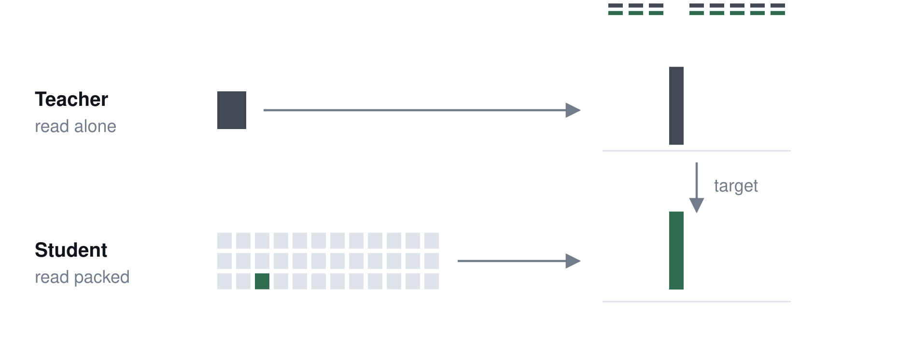
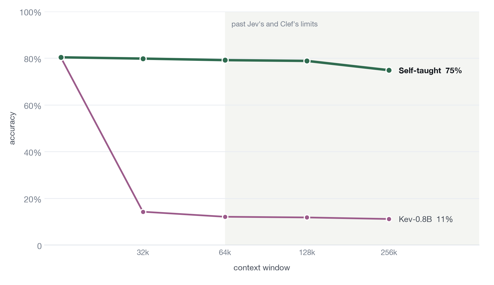
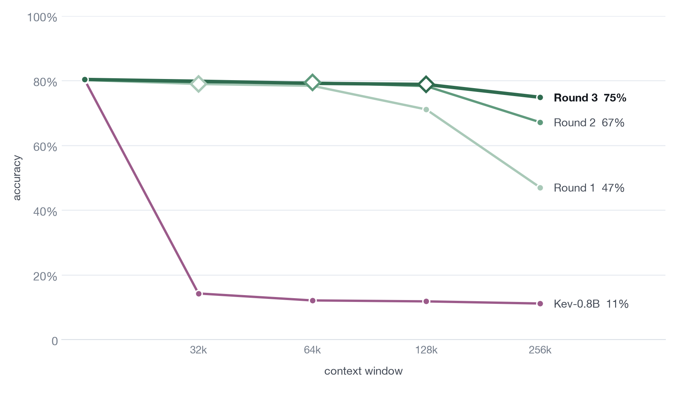

# A decision model that teaches itself

Kev-0.8B teaches itself to read about 1,000 documents (256k tokens) at once, with no labels.

Blog: [A decision model that teaches itself](https://www.larrisx.com/studio/self-taught-kev)

Model: [LarrisX/kev-0.8b-selfteach](https://huggingface.co/LarrisX/kev-0.8b-selfteach)

Data: [LarrisX/packed-complaints](https://huggingface.co/datasets/LarrisX/packed-complaints)



Decision models such as [Kev](https://github.com/jaredpalmer/kev), TypeSafe's Jev and Cloudflare's Clef read an input
once and answer typed questions about it, with a probability for each option. Every question branches off that single
read, so asking about every item in a long input costs a small fraction of asking about each one separately.

Asked which product each of 1,980 consumer complaints is about (nine options), Kev-0.8B gets **80%** right one
complaint at a time. Pack 246 of them into one 64k token input and it drops to **12%**, barely above random. After
self-teaching, it scores **78%** at 64k, and holds up to context lengths that most decision models today don't support with **75%** with 256k.



## How it works

1. **Teacher.** Kev-0.8B reads each complaint by itself and gives a probability for each option.
2. **Student.** The same model reads that complaint packed among up to 140 others and is trained to give the same probabilities.

I used [5,219 complaints](https://huggingface.co/datasets/davidheineman/consumer-finance-complaints-large) the model had never seen, with about a third of training examples left alone to ensure the model is able to still answer short inputs accurately. Similarly, other kinds of questions from Kev's public training data were also mixed in, also answered by the teacher, so it stays a general decision model.

I used a small LoRA adapter, trained for 46 minutes on one rented H100, which cost about $2.

## Results

- 78% accuracy at 64k against 80% alone, up from 12%.
- It beats the same model trained on the real labels (75%).
- **It beats Kev-9B** (51%) and lands within 2 points of Clef 27B (80%). Kev-27B stays 7 points ahead, but it is also
  better on a complaint read alone (86% vs 80%).
- Packed answers match the alone answers 89% of the time, up from 13%.
- **Nothing else broke.** On Kev's own suites, paired against base Kev-0.8B: decision-v7 +0.4 [−0.5, +1.4], transfer-v4 −1.3 [−3.4, +0.8].

## Past the 64k window

Existing decision models are limited or struggle beyond 64k tokens, so using the same teacher-student method with longer training documents:

| Round | Starts from | Training documents | Time on one H100 |
|---|---|---|---|
| 1 (`fresh-32k`) | Kev-0.8B | up to 32k tokens | 46 min |
| 2 (`fresh-64k`) | round 1 | up to 64k tokens | 42 min |
| 3 (`fresh-128k`) | round 2 | up to 128k tokens | 45 min |



*Diamonds mark the longest document each round trained on. Each round holds up to about twice that length.*

The final finetuned model scores 79% at 128k and 75% at 256k, where base Kev-0.8B is at chance at both. Scoring past 64k uses
`bench/chunked_scorer.py`, which runs Kev's scorer with the questions in batches; it matches Kev's unpatched scorer
on every question where both run. Training past 64k lifts Kev's 64k training cap for that run (`infra/runpod/train.sh`).

## Try the model

The model is a Kev checkpoint, so Kev's own server runs it: a TypeSafe-compatible API on your machine (CUDA, or MLX on
Apple Silicon).

```bash
git clone https://github.com/jaredpalmer/kev.git && cd kev && git checkout fe64b12
uv sync --extra serve
uv run --extra serve python -m kev.serve --run LarrisX/kev-0.8b-selfteach --port 8009
```

Put every item in one input, give each an ID, and ask about each item by its ID:

```bash
curl -s localhost:8009/v1/systemone -H 'content-type: application/json' -d '{
  "model": "kev-latest",
  "state": "Ticket T-101:\nMy mortgage servicer added a late fee even though my payment cleared on time.\n\nTicket T-102:\nA collector keeps calling about a medical debt I already paid off.\n\nTicket T-103:\nI sent money to my sister through an app and it never arrived.",
  "questions": {
    "T-101": {"type": "choice", "instructions": "Which kind of financial product is ticket T-101 about?",
              "criteria": {"mortgage": "A mortgage or home loan", "debt_collection": "Collection of a debt",
                           "money_transfer": "A money transfer or money service", "card": "A credit card or prepaid card"}},
    "T-102": {"type": "choice", "instructions": "Which kind of financial product is ticket T-102 about?",
              "criteria": {"mortgage": "A mortgage or home loan", "debt_collection": "Collection of a debt",
                           "money_transfer": "A money transfer or money service", "card": "A credit card or prepaid card"}},
    "T-103": {"type": "noul", "instructions": "Did the money in ticket T-103 reach the recipient?"}
  }}'
```

```json
{
  "model": "kev-latest",
  "answers": {
    "T-101": {"type": "choice", "choice": "mortgage", "confidence": 0.9997, "probabilities": {"mortgage": 0.9997, "...": "..."}},
    "T-102": {"type": "choice", "choice": "debt_collection", "confidence": 0.9938, "probabilities": {"debt_collection": 0.9954, "...": "..."}},
    "T-103": {"type": "noul", "noul": 0.0005}
  },
  "usage": {"input_tokens": 206, "output_tokens": 190},
  "latency_ms": 64.4
}
```

From Python, the TypeSafe SDK (installed by `uv sync --extra serve`) talks to the same server:

```python
from typesafe_sdk import Choice, TypeSafeClient

client = TypeSafeClient(api_key="local", base_url="http://127.0.0.1:8009", model="kev-latest")
products = {"mortgage": "A mortgage or home loan", "debt_collection": "Collection of a debt",
            "money_transfer": "A money transfer or money service", "card": "A credit card or prepaid card"}
tickets = {"T-101": "My mortgage servicer added a late fee even though my payment cleared on time.",
           "T-102": "A collector keeps calling about a medical debt I already paid off.",
           "T-103": "I sent money to my sister through an app and it never arrived."}
response = client.system_one(
    state="\n\n".join(f"Ticket {k}:\n{v}" for k, v in tickets.items()),
    questions={k: Choice(instructions=f"Which kind of financial product is ticket {k} about?", criteria=products)
               for k in tickets},
)
print({k: response.choices[k].choice for k in tickets})   # {'T-101': 'mortgage', 'T-102': 'debt_collection', 'T-103': 'money_transfer'}
```

Kev's server refuses inputs over 64k tokens so to read longer ones, raise that limit in your Kev checkout
before starting the server:

```bash
sed -i.bak 's/^SERVE_MAX_STATE = 65536$/SERVE_MAX_STATE = 262144/' kev/model.py
```

On an Apple M5 laptop (MLX, bf16), a 122k-token input with 509 questions took 84 seconds and a 244k-token input with
997 questions took 6 minutes.

**Tips**
- Label each item with an ID and name that ID in its question, as above. Training used headers like `Complaint 1234:`,
  `Complaint #1234`, `[Complaint 1234]` and `Case 1234:`.
- Every question is answered on its own, so one input with 500 questions gives the same answers as 500 separate ones,
  at a fraction of the cost.
- The training complaints all used one product question; other questions rely on Kev's general skills, which
  self-teaching kept (see Kev's suites above). Check accuracy on your own items before relying on it.

## Codebase

```
selfteach/          training side: one builder per training set, then targets and analysis
  common.py           shared: items, packing into documents, Kev's records, tokenizer and context
  build_kev_items.py  kev-items: the first attempt (Kev's own training complaints), and the decision-records teacher suite
  build_fresh.py      fresh-32k: fresh CFPB complaints, documents to 32k (the headline model; --seed 1 for fresh-32k-seed1)
  build_ndas.py       fresh-32k-ndas: the same plus fresh ContractNLI NDAs
  build_longer.py     fresh-64k, fresh-128k: the same items repacked into longer documents
  filter.py           drop packed records that don't fit the training context (Kev's environment)
  targets.py          teacher answers -> soft targets (Kev's environment, on the GPU box)
  report.py           self-taught analyses (agreement with the alone answer, edge errors) -> results/selfteach.json
baseline/           the label-trained comparison (labels-32k): the same model trained on the real labels
  build.py            training data: labelled complaint documents, buried records, synthetic evidence tasks, replay
  synthetic.py        synthetic long-document evidence tasks with programmatic labels
  fillers.py          their SQuAD and AG News filler
  sports_filter.py    the "no sports" drop list for one filler pool -> nonsports_drop.json (Kev's environment)
bench/              test side: one folder per test
  complaints/         the packed-complaints test
    build.py            suite, alone to 64k
    build_long.py       suite, 128k and 256k
    split.py            scoring copies with each document's questions in groups (fits Kev's scorer in GPU memory)
    report.py           -> results/complaints.json
    report_long.py      -> results/complaints_long.json
    jev.py, clef.py     hosted references (evaluation only)
  contracts/          the packed-contracts test (CUAD, Kev's longdoc layout)
    build.py, report.py (-> results/contracts.json), hosted.py (Jev and Clef, evaluation only)
  regression.py       Kev's own short-question suites, paired -> results/regression/<run>.json
  chunked_scorer.py   Kev's scorer with question branches chunked, for 128k+ (evaluation only)
  chunked_check.py    checks the chunked scorer against Kev's unpatched one
  hosted.py           shared Jev / Clef API client
infra/
  runpod/             GPU steps on one H100: teacher.sh, train.sh, score.sh (+ setup, self-stop); README has every run
  modal/              the Modal app used for the label-trained baseline and the first Kev reads
results/            tracked summaries (JSON); figures.py draws results/figures/ from them
data/               local only: Kev checkout, raw data, suites, model rows, checkpoints
```

## Setup

```bash
uv sync
git clone https://github.com/jaredpalmer/kev data/kev && git -C data/kev checkout fe64b12   # Kev's code and suites
(cd data/kev && uv sync --frozen)   # Kev's own environment, for kev.benchmark / kev.train and the scripts that import kev
```

Inputs expected under `data/`:

| Path | What |
|---|---|
| `data/kev/` | Kev at commit fe64b12 (Apache-2.0), including `evals/decision-v2`, `evals/v7`, `evals/v4`, `evals/longdoc-v1` |
| `data/cfpb/train-00010.parquet` | CFPB complaints, shard 10 of the Hub snapshot `davidheineman/consumer-finance-complaints-large` @ 44cfa17 (US government work) |
| `data/cfpb/kev_documents_v1_train.jsonl` | Kev's documents-v1 train split, used only to keep it out of the test and the fresh items |
| `data/contractnli/` | ContractNLI (CC BY 4.0), for the fresh-32k-ndas run |
| `data/squad_train.parquet` | SQuAD train, `rajpurkar/squad` @ 7b6d24c (CC BY-SA 4.0), filler for the baseline's synthetic tasks |
| `data/ag_news_train.parquet` | AG News train, `fancyzhx/ag_news` @ eb185aa, filler for the baseline's synthetic tasks |

```bash
curl -sL -o data/squad_train.parquet https://huggingface.co/datasets/rajpurkar/squad/resolve/7b6d24c440a36b6815f21b70d25016731768db1f/plain_text/train-00000-of-00001.parquet
curl -sL -o data/ag_news_train.parquet https://huggingface.co/datasets/fancyzhx/ag_news/resolve/eb185aade064a813bc0b7f42de02595523103ca4/data/train-00000-of-00001.parquet
```

## Reproduce

```bash
# the tests (CPU)
uv run python -m bench.complaints.build --out data/packed-complaints-v0
uv run python -m bench.complaints.split            # scoring copies: packed-complaints-v0-split{,-long}
uv run python -m bench.complaints.build_long       # 128k / 256k: packed-complaints-v1{,-check}
PYTHONPATH=data/kev data/kev/.venv/bin/python bench/contracts/build.py

# training data (CPU): each run's items alone (for the teacher) and its packed documents, under data/selfteach/<run>/
uv run python -m selfteach.build_kev_items                                            # kev-items, and the decision records every run reuses
uv run python -m selfteach.build_fresh                                                # fresh-32k (headline)
uv run python -m selfteach.build_fresh --seed 1 --out data/selfteach/fresh-32k-seed1  # its second seed
PYTHONPATH=data/kev data/kev/.venv/bin/python selfteach/build_ndas.py                 # fresh-32k-ndas
uv run python -m selfteach.build_longer                                               # fresh-64k
uv run python -m selfteach.build_longer --records 400 --asked 12 --min_len 32000 --max_len 125000 --seed 1 --out data/selfteach/fresh-128k
data/kev/.venv/bin/python selfteach/filter.py data/selfteach/<run>/packed.jsonl        # every run; add 65536 / 131072 for fresh-64k / fresh-128k

# the label-trained baseline (CPU): labels-32k and its second seed, each filtered to the 32k training limit
uv run python -m baseline.build                                                    # labels-32k
uv run python -m baseline.build --seed 1 --out data/baseline/labels-32k-seed1/train.jsonl  # labels-32k-seed1
data/kev/.venv/bin/python selfteach/filter.py data/baseline/labels-32k/train.jsonl      # and data/baseline/labels-32k-seed1/train.jsonl

# GPU (one H100): teacher answers, training, scoring -> infra/runpod/README.md
# the baseline trains on its labels directly, with kev.train's settings from train.sh (no teacher targets):
#   kev.train --data data/baseline/labels-32k/train.jsonl --init_from jaredpalmer/kev-0.8b --max_state 32768 --shared_prefix 1 \
#     --checkpointing 1 --dtype bf16 --weights_dtype fp32 --lr 5e-5 --accum 4 --batch 1 --epochs 1 --seed 0   # --seed 1 for -s1

# reports, from the score rows in data/kevbench/results/
uv run python -m bench.complaints.report && uv run python -m bench.complaints.report_long
uv run python -m bench.contracts.report && uv run python -m selfteach.report
uv run python -m bench.regression fresh-32k decision-v7 transfer-v4   # each run
uv run python results/figures.py                                      # the figures above
```

## Notes

- All scores use Kev's own scorer (`kev.benchmark`) and suites. Our scoring of base Kev-0.8B 1.0 reproduces Kev's published rows bit for bit.
- Jev and Clef were queried only for evaluation. No hosted model output is used to train anything.

## Licence

Apache-2.0 (see [LICENSE](LICENSE) and [NOTICE](NOTICE)). Data is not redistributed and keeps its own licence.
